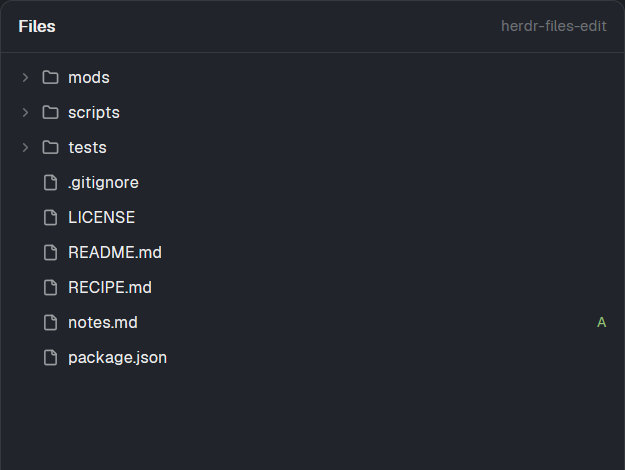

# Files Edit

The Files side panel of Herdr, with two additions: a text file opens in an editor
you can change and save (the header shows what is unsaved, and a save never
overwrites a change someone else made on disk), and a right-click on a file or
folder in the tree copies its full path. Everything else is Herdr's Files: the
folder of the focused terminal as a tree, git change marks, the same look.

## What you see

One column filling its block: `background` color, radius 10, 1px `border`, base
text 13px in `foreground`. Top to bottom:

- **Header**, 42px, 14px side padding, 8px gap, bottom border. A `←` (20px wide,
  `muted`) only while a file is open; "Files" at 13px semibold; then, filling
  the rest and right-aligned at 12px in `dim`, truncated: the folder's name, or
  while a file is open its path inside the folder. With unsaved changes that
  text is `● path · unsaved` in `blocked`. While a file you can edit is open, a
  **Save** button ends the row: 22px tall, 8px side padding, radius 5, 12px;
  `accent` with `accent_foreground` text when there is something to save,
  `hover` with `foreground` text when not, "Saving…" while it writes.
- **Bars**, only while they have something to say, each under the header: 12px
  side padding 12px, 6px vertical, 8px gap, bottom border, 12px text that wraps,
  with 22px buttons (as Save) on the right.
  - Read-only: `Read-only · <why>` in `dim`.
  - Changed on disk: `<name> changed on disk since you opened it. Your changes
    are kept here, and nothing was saved.` (or `was deleted on disk.`) in
    `blocked`, with **Reload** and **Overwrite** (**Recreate** if deleted; this
    one in `accent`).
  - A save that failed for another reason: `Could not save <name>: <message>`
    in `ansi1`.
  - Leaving a file with unsaved changes: `<name> has unsaved changes.` in
    `blocked`, with **Save** (accent), **Discard**, **Keep editing**.
- **The tree**, no file open: a column that scrolls, 6px padding. Rows are 28px,
  radius 7, `hover` background on hover, left padding 8 + 18 per level, right 8,
  7px gap: a 12px chevron (`mods/files-edit/chevron-right.svg` or
  `chevron-down.svg`, `dim`) on folders and a 12px blank on files, a 14px icon
  (`folder.svg` / `file.svg`, `muted`), the name (fills the row, truncated),
  and on the right a git mark at 11px: `A` (`ansi2`), `D` or `U` (`ansi1`),
  `M` (`blocked`). Folders before files, then by name (`localeCompare`).
  Under the rows: "Loading files…", "No files", "No folder" or the error, 12px
  `dim`; and, when a list was cut, "File list limited to 500 entries per folder
  and 5,000 total" at 11px `dim`.
- **The file**, a file open: Herdr's `Editor` filling the rest, 12px in the
  settings' `font_family`, line numbers, syntax colors from the theme
  (`keyword` ansi5, `string` ansi2, `comment` dim, `function` ansi4, `type`
  ansi3, `number` ansi1, `constant` ansi6). A file that can't be shown has one
  `dim` line there instead.

## How it behaves

- **Folder.** The focused terminal's folder (its pane's `cwd`, else the focused
  `cwd`, else the space's folder), on its machine. It reloads every 10 seconds
  and when the folder changes (`watchFolder`, not for another machine). Open
  folders and the open file are remembered per folder.
- **Click** a folder: open or close it (its contents load when first opened). Click
  a file: open it. `←`: close the file.
- **Right-click** a row (file or folder): the full path goes to the clipboard,
  written as the system writes it (`C:\a\b` for this computer on Windows,
  `/a/b` otherwise), and the header text is replaced for 1.8 seconds by
  `✓ Path copied · <name>` in `ansi2`. It does nothing else: a folder is not
  opened or closed and a file is not opened. If the release also arrives as a
  click, that click is dropped.
- **Editing.** Typing changes the text; the text is "unsaved" exactly when it
  differs from what the editor held right after loading the file (so undoing
  back to the start clears it). Save, or Ctrl+S (also `cmd`) while the editor
  has the keyboard, writes it; the header shows `✓ Saved <name>` for 1.8
  seconds. The buttons do what they say; **Reload** reads the file again and
  drops the edits; **Overwrite** reads the disk as it is now and writes over it.
- **Never a silent overwrite.** A save calls `writeTextFile(path, text,
  expected)` with `expected` = the exact text last read from or written to disk.
  If it refuses, the file is read again: different (or gone) means the bar
  above; the same means a real write error. The 10-second refresh reads the
  open file too: unedited and changed, the new text is shown; edited and
  changed, the bar appears and the edits stay.
- **Line endings.** A file whose every line ends in CRLF is edited with LF and
  written back with CRLF.
- **Read-only, with the reason in the bar** (the editor is read-only and there
  is no Save): over 400,000 characters (the start is shown, then
  `… (file truncated)`); text with U+FFFD (not valid UTF-8); mixed or lone-CR
  line endings; any file on another machine (`writeTextFile` has no machine).
  A file with a NUL has no text view and says `Binary file · no text preview`;
  one that can't be read says `Read-only · this file cannot be shown (binary,
  over 1 MiB, or unreadable)`.
- **Going back with unsaved changes** shows the bar with Save (saves, then
  closes), Discard, Keep editing. The edits also survive the panel following the
  terminal to another folder: they come back, with their original baseline, when
  that folder is shown again (a save of them still checks the disk).

## Built from

- One mod, `mods/files-edit/` (`mod.json` `{ "place": "none" }`), copied from
  Herdr's own `files` mod and changed. `main.js` is the view; `edit.js` has the
  parts that need no API: `classify(raw, { remote })` (binary / read-only
  reason / LF text and eol), `toDisk`, `diskState`, `fullPath`, `baseName`.
  Four icons: `chevron-down.svg`, `chevron-right.svg`, `file.svg`, `folder.svg`
  (Lucide), referenced as `mods/files-edit/<name>.svg`, never `mods/files/`.
- In a layout it is a block with `"id": "files"` in the `panel-body` stack,
  `content.mod` `files-edit` (keeping the id keeps the tab bar's Files button
  and keys working); where it has `props.icon` it is `mods/files-edit/file.svg`.
  `scripts/files-edit-layout.mjs apply|restore <layout.json>` makes exactly that
  change as a text edit and checks it changes nothing else.
- From `herdr`: `spaces`, `panes`, `focused`, `exec`, `readTextFile`,
  `writeTextFile`, `watchFolder`, `theme`, `settings`, `window`. From
  `gpui-base`: `v_flex`, `h_flex`, `Editor`, `EditorState`. From `gpui-kit`:
  `View`, `div`, `svg`.
- Programs it runs, as Herdr's Files: a listing (`powershell` on Windows, else
  `sh`, with `on` for another machine), `git rev-parse --show-toplevel`, and
  `git --no-optional-locks -c core.fsmonitor=false status --porcelain=v1 -z
  --no-renames --untracked-files=all`. No network.
- Editor: `EditorState.new({ language, readonly, value, font_family,
  font_size: 12, syntax })`; `.value()`, `.on("change", …)`, `.release()`.
  Language is the file's extension (`ts tsx mts cts jsx mjs` → `js`, `toml` →
  `yaml`, `jsonc` → `json`, `svelte vue` → `html`).
- Right-click: `.on_mouse_down("right", (_e, cx) => { cx.stop_propagation(); …
  cx.write_to_clipboard(text) })` on the row, and `.on_mouse_down("left", …)` to
  clear the mark that makes `on_click` skip one click.

## Watch out

- `ClickEvent` has no button, so a right-click can't be told from a click inside
  `on_click`. Mark the right press, skip the next click, and clear the mark on
  every left press so it can never swallow a real click.
- `writeTextFile` takes no `on`: never offer to save a file on another machine.
- Compare with the editor's own `value()` taken right after loading, not with
  the disk string: the editor may normalize text, and everything would read as
  unsaved.
- `readTextFile` returns up to 1 MiB. Never use the cut text (400,000
  characters) as anything to save or to expect.
- Pass `expected` exactly as read (CRLF included), not the LF text of the editor.
- Create `EditorState` in an event handler or `cx.spawn`, never in `render`.
- A check of the open file must ignore its own result if the file was saved or
  reopened meanwhile.
- Whether Ctrl+S reaches the panel while the editor has the keyboard depends on
  the editor; the Save button is the sure way.
- Unsaved edits live in memory only; a closed panel or app loses them.
- It assumes the layout's panel keeps the block id `files`.

## Done when

- The tree shows the same rows and marks as Herdr's Files for a folder, and a
  folder over 500 entries says so.
- Right-clicking a folder and a file puts their full paths on the clipboard,
  shows `✓ Path copied · name`, and opens or closes nothing.
- Opening a text file, typing, shows `● name · unsaved` and a lit Save; Save
  writes it, and the mark goes. A CRLF file is still CRLF on disk.
- Changing the file from a terminal while it holds unsaved edits, then Save, writes
  nothing and shows Reload / Overwrite; Overwrite writes yours; Reload shows the
  other text.
- A binary file, a file over 400,000 characters and a file on another machine each
  say why they are read-only and have no Save.
- `←` on an unsaved file asks first.
- `herdr-app check` passes on the mod, and no file in it names `mods/files/`.
